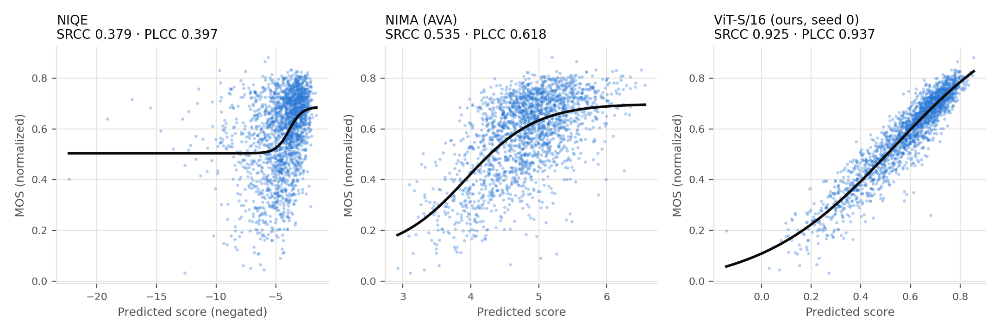
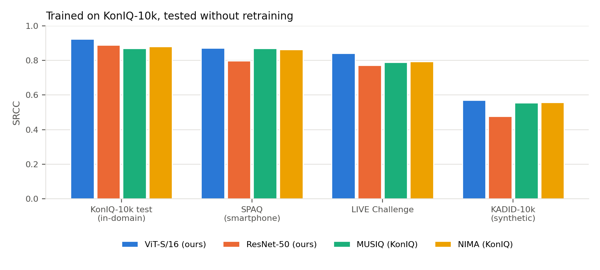
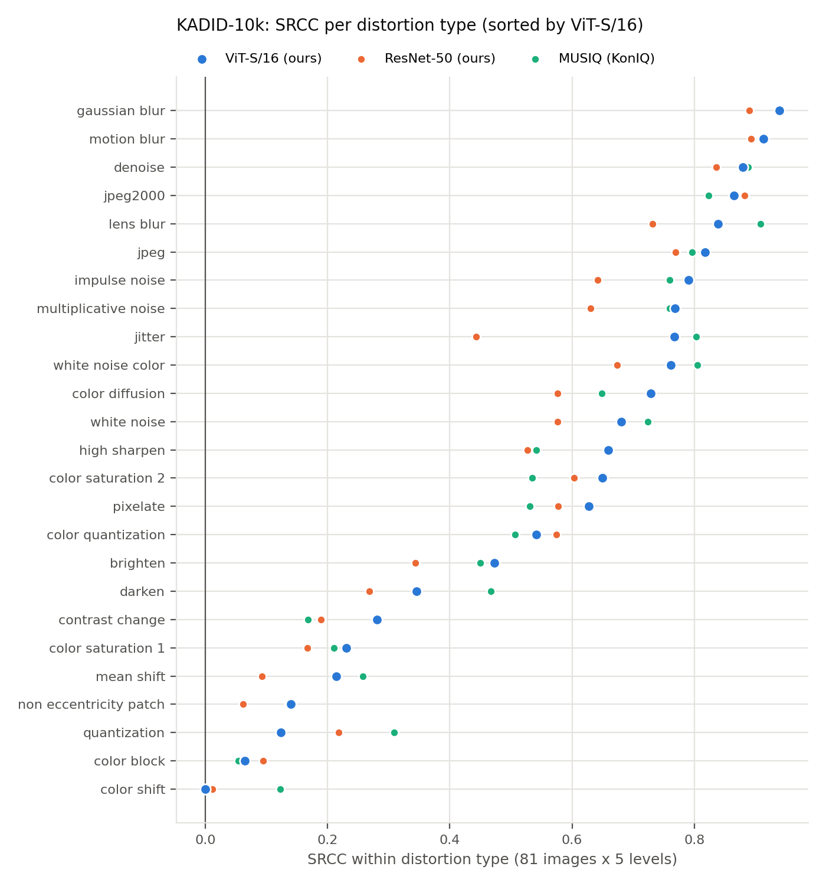
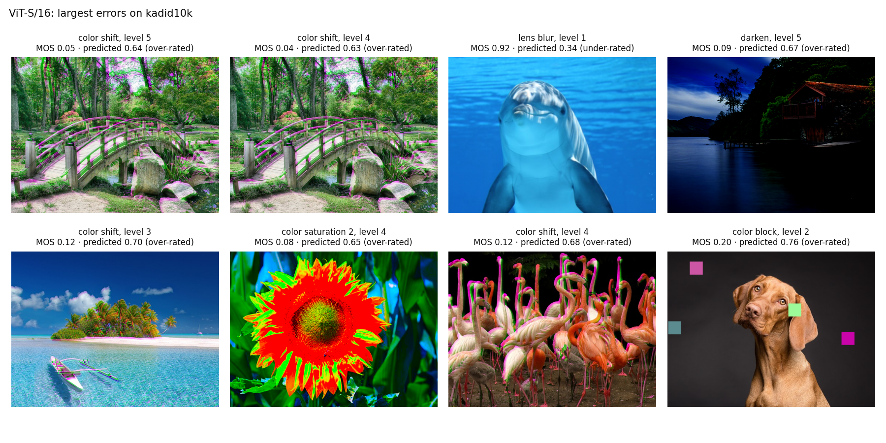

# Learned Image Quality Assessment Benchmark

Do modern deep models fine-tuned on human quality ratings predict perceived image quality better than classical metrics, how well do they generalize across datasets, and on which distortion types do they fail?

> **Status:** main benchmark, cross-dataset generalization and per-distortion analysis complete. All numbers below are measured results.

## Motivation

In applied industry work on automatic photo quality scoring, we found that widely used no-reference metrics such as NIQE, BRISQUE and NIMA often disagreed with human judgments of real photos. This project measures that gap on public benchmarks. It fine-tunes CNN and ViT backbones on crowdsourced quality scores, compares them with classical and learned baselines under one evaluation protocol, and tests whether the learned models still work on data they were not trained on.

## Main results

KonIQ-10k official test split (2,015 images). SRCC is the primary metric. PLCC is computed after 4-parameter logistic fitting. Trained models: mean ± std over 3 seeds unless noted. All methods receive the same 512×384 input; baselines use pretrained weights from pyiqa without retraining.

| Method | Type | Trained on | SRCC | PLCC |
|---|---|---|---|---|
| NIQE | classical | none (natural-scene statistics) | 0.379 | 0.397 |
| BRISQUE | classical | LIVE (synthetic) | 0.231 | 0.248 |
| NIMA | learned | AVA (aesthetics) | 0.535 | 0.618 |
| NIMA | learned | KonIQ-10k | 0.880 | 0.911 |
| CLIP-IQA | zero-shot | none | 0.642 | 0.725 |
| MUSIQ | learned | KonIQ-10k | 0.870 | 0.902 |
| ResNet-50 (ours), backbone lr 1e-5 | fine-tuned | KonIQ-10k | 0.825 ± 0.007 | 0.853 ± 0.004 |
| ResNet-50 (ours), backbone lr 1e-4 | fine-tuned | KonIQ-10k | 0.892 (1 seed) | 0.911 (1 seed) |
| **ViT-S/16 (ours)** | fine-tuned | KonIQ-10k | **0.926 ± 0.001** | **0.937 ± 0.000** |



### Resolution ablation (baselines)

The same baselines on the same 2,015 test images at native 1024×768 resolution vs. the 512×384 input used in the main table.

| Method | SRCC @ 512×384 | SRCC @ 1024×768 | Δ |
|---|---|---|---|
| NIQE | 0.379 | 0.529 | +0.150 |
| BRISQUE | 0.231 | 0.222 | −0.009 |
| NIMA (AVA) | 0.535 | 0.528 | −0.008 |
| NIMA (KonIQ) | 0.880 | 0.879 | −0.002 |
| CLIP-IQA | 0.642 | 0.684 | +0.042 |
| MUSIQ (KonIQ) | 0.870 | 0.945 | +0.075 |

Downsampling removes fine detail that NIQE and the multi-scale MUSIQ rely on, while NIMA is essentially unaffected. MUSIQ at native resolution exceeds its published KonIQ-10k result (0.916). Its released checkpoint may have been trained on a split that differs from the official one, so it is treated here as a reference rather than a strictly comparable competitor.

## Cross-dataset generalization

Models trained on KonIQ-10k are scored on other datasets **without any retraining** (SRCC; our models: seed 0).

| Method | KonIQ-10k test | SPAQ (smartphone) | LIVE Challenge | KADID-10k (synthetic) |
|---|---|---|---|---|
| **ViT-S/16 (ours)** | **0.924** | **0.872** | **0.842** | **0.571** |
| ResNet-50 (ours, lr 1e-4) | 0.889 | 0.797 | 0.772 | 0.476 |
| MUSIQ (KonIQ) | 0.870 | 0.869 | 0.789 | 0.556 |
| NIMA (KonIQ) | 0.880 | 0.864 | 0.793 | 0.557 |
| NIQE | 0.379 | 0.699 | 0.449 | 0.379 |
| BRISQUE | 0.231 | 0.501 | 0.313 | 0.330 |



- ViT-S/16 remains the best method on every dataset, but its margin over the strongest baseline shrinks from +0.044 in-domain to +0.003 on SPAQ. Part of the in-domain gain reflects fitting KonIQ-10k's distribution rather than more general quality perception.
- ResNet-50 generalizes worse than ViT-S/16 (−0.092 on SPAQ vs. −0.052).
- Every authentic-distortion model collapses on synthetic distortions (KADID-10k, ≈0.48–0.57).

## Failure modes by distortion type (KADID-10k)

SRCC within each of the 25 KADID-10k distortion types (81 reference images × 5 levels each).



- **Handled well:** blur (Gaussian 0.94, motion 0.91, lens 0.84), compression (JPEG2000 0.87, JPEG 0.82) and denoising artifacts (0.88), which are common in real photos.
- **Nearly invisible to the model:** color and photometric changes. These include color shift (0.00), color block (0.07), quantization (0.12), non-eccentricity patch (0.14), mean shift (0.21), color saturation (0.23), contrast change (0.28) and darkening (0.35). MUSIQ and ResNet-50 show the same pattern.
- The largest errors are severely color-shifted or darkened images that the model rates as acceptable. On KonIQ-10k, all eight largest errors are over-rated, and several are strongly color- or tone-manipulated photos (posterized, edge-filtered, high-contrast black and white).



A plausible explanation, not tested here, is that ImageNet pretraining with color-jitter augmentation encourages color-invariant features, and KonIQ-10k contains few strong color distortions to counteract it.

## Key findings

1. **In-domain, a fine-tuned ViT-S/16 is the strongest model at matched resolution.** It reaches 0.926 ± 0.001 SRCC on KonIQ-10k, compared with 0.880 for the best baseline, while classical metrics barely track human ratings (NIQE 0.38, BRISQUE 0.23). Training details matter as much as architecture: raising ResNet-50's backbone learning rate from 1e-5 to 1e-4 lifts it from 0.825 to 0.892.
2. **Most of the in-domain advantage does not transfer.** Zero-shot, ViT-S/16 drops by 0.05 on smartphone photos (SPAQ), by 0.08 on LIVE Challenge and to 0.57 on synthetic distortions. Its lead over KonIQ-trained baselines shrinks from +0.044 to +0.003 on SPAQ.
3. **Learned IQA models are largely blind to color and photometric distortions.** On KADID-10k they rank blur and compression well (SRCC 0.82–0.94) but fail on color shift, color block, quantization and contrast changes (0.00–0.28). The worst errors are heavily color-shifted or darkened images rated as acceptable.

## Plan

| Experiment | Data | Question |
|---|---|---|
| Main benchmark | KonIQ-10k (train 7,058 / val 1,000 / test 2,015) | Do fine-tuned models beat classical and early learned metrics? |
| Cross-dataset | SPAQ (smartphone, ~11k), LIVE Challenge (1,162) | How much does accuracy drop without retraining? |
| Distortion analysis | KADID-10k (81 refs × 25 distortions × 5 levels) | Which distortion types are hardest? |
| Ablations (optional) | KonIQ-10k | Input resolution, frozen vs. fine-tuned backbone, loss choice |

**Protocol.** All scores are normalized to [0, 1] with higher = better. Lower-is-better metrics (NIQE, BRISQUE) are sign-flipped before computing correlations. Checkpoints are selected on the validation split, and the test split is evaluated once. Augmentation is limited to horizontal flips (and random crops where used), because color, brightness or blur changes would alter perceived quality and invalidate the labels.

**Models.** ImageNet-pretrained ResNet-50 and ViT-S/16 (timm), global pooling + `Linear(features, 1)`, L1 loss, AdamW (backbone lr 1e-5, head lr 1e-3, head bias initialized to the mean training MOS), cosine schedule. KonIQ images are used at 512×384 without cropping.

## Reproduce

Designed for a free Colab or Kaggle GPU. The quickest route is [`notebooks/01_baselines.ipynb`](notebooks/01_baselines.ipynb).

```bash
pip install -r requirements.txt
python scripts/download_data.py --datasets koniq10k     # add spaq livec kadid10k for phase 3
python scripts/run_baselines.py                          # writes results/baselines/
python -m src.train --config configs/overfit.yaml        # sanity check (64 images)
bash scripts/train_all.sh                                # 2 backbones x 3 seeds, tables, figure
python -m src.cross_eval --runs vit_s16_seed0 resnet50_lr1e-4_seed0   # zero-shot on SPAQ / LIVEC / KADID
python scripts/analyze_cross.py                          # cross-dataset table, per-distortion analysis, error cases
```

Training entry point for Colab / Kaggle: [`notebooks/02_train.ipynb`](notebooks/02_train.ipynb). Every epoch saves a resumable checkpoint, and finished runs are skipped on rerun.

**Data.** Datasets are not stored in this repository. `download_data.py` fetches images and metadata (including the official KonIQ-10k split) from the [pyiqa dataset mirror](https://huggingface.co/datasets/chaofengc/IQA-PyTorch-Datasets). Please respect each dataset's original license: [KonIQ-10k](https://database.mmsp-kn.de/koniq-10k-database.html), [SPAQ](https://github.com/h4nwei/SPAQ), [LIVE Challenge](https://live.ece.utexas.edu/research/ChallengeDB/), [KADID-10k](https://database.mmsp-kn.de/kadid-10k-database.html).

## Repository layout

```
configs/    experiment configs (YAML)
src/        datasets.py, models.py, train.py, evaluate.py, cross_eval.py, utils.py
scripts/    download_data.py, run_baselines.py, train_all.sh, make_tables.py, plot_scatter.py, analyze_cross.py
notebooks/  Colab / Kaggle entry points
results/    per-image predictions and summary tables (committed)
report/     technical report
```

## Limitations

- Pretrained MUSIQ and NIMA-KonIQ weights come from pyiqa and were trained on KonIQ-10k by their authors. They are strong in-domain references, not methods we trained ourselves.
- KADID-10k contains synthetic distortions, while KonIQ-10k contains authentic ones, so results there measure a domain shift as well as per-distortion difficulty.
- Cross-dataset and KADID-10k results use one seed per model; the main KonIQ-10k results use three.
- The color-invariance explanation for the KADID-10k failures is a hypothesis; testing it (for example, pretraining without color jitter) is future work.
- Free-tier GPUs limit model size and resolution; larger backbones are out of scope.

## Acknowledgements

Baselines and dataset mirrors are provided by [pyiqa (IQA-PyTorch)](https://github.com/chaofengc/IQA-PyTorch). Backbones come from [timm](https://github.com/huggingface/pytorch-image-models).
